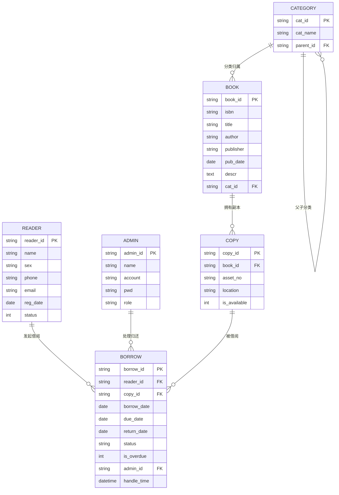

# 图书管理系统 · 数据库设计总述

> 作者：张展博 · 2026-11-28
> 本文档整合小组报告的第一章（需求分析）与第二章（数据库设计），包含：
> 1. 需求分析（业务背景、用户角色、核心流程、数据对象、业务规则）
> 2. 概念设计（ER 图说明、实体属性、联系分析）
> 3. 逻辑设计（ER→关系模式转换、PK/FK、范式检查）
> 4. 反范式设计（冗余字段与一致性维护）

---

# 第一章 需求分析

## 1.1 系统背景与业务范围

图书馆需要管理读者、图书、馆藏副本以及借阅归还过程。手工或分散管理容易出现副本状态不一致、逾期难统计、借阅历史难追踪等问题。本项目以"图书管理系统"为选题，目标是设计一个能支撑上述业务的数据库，并用 Java/JDBC 命令行程序完成核心数据操作。

**纳入范围**：
- 读者信息管理：注册信息、联系方式、账户状态
- 管理员信息管理：登录账号、角色、密码哈希
- 图书与分类管理：书目信息、多级分类、馆藏副本
- 借阅业务：借书、还书、续借、逾期判定
- 查询与统计：书目检索、借阅历史、热门图书、分类馆藏量、当前逾期、每月借阅量

**不在范围**：
- 预约履约、罚金支付、邮件/短信通知
- 多馆区、通借通还、读者信用评分

## 1.2 系统用户角色

| 角色 | 主要操作 |
|------|----------|
| 读者 | 查询书目及可借副本、发起借书、查看个人借阅历史、发起归还/续借 |
| 管理员 | 维护读者、书籍、分类、副本信息；处理归还；查看统计报表 |
| 超级管理员 | 在管理员基础上维护管理员账号与角色 |

## 1.3 核心业务流程

### 借书流程
1. 校验读者状态正常（`Reader.status = 1`）
2. 校验副本在馆（`Copy.is_available = 1`）
3. 校验读者在借数量未达上限（5 本）
4. 写入 `Borrow` 记录：`borrow_date = CURDATE()`，`due_date = borrow_date + 30 天`，`status = '在借'`
5. 将对应 `Copy.is_available` 置为 0
6. 以上步骤必须在同一事务中完成

### 还书流程
1. 写入 `return_date = CURDATE()`、`status = '已归还'`、`admin_id`、`handle_time = NOW()`
2. 按当时是否超期写入 `is_overdue`
3. 将对应副本 `is_available` 置为 1

### 续借流程
1. 仅允许 `return_date IS NULL` 的在借记录续借
2. `due_date` 顺延 30 天，`status = '在借'`，`is_overdue = 0`

## 1.4 业务规则与约束

| 编号 | 规则 | 实现位置 |
|------|------|----------|
| BR-01 | 管理员账号唯一 | `Admin.account` 唯一约束 |
| BR-02 | 密码必须哈希存储（SHA256） | 应用层写入 |
| BR-03 | 分类支持多级，根节点父编号为空 | `Category.parent_id` 自引用外码 |
| BR-04 | 馆藏编号唯一 | `Copy.asset_no` 唯一约束 |
| BR-05 | 借书按副本进行，不直接借书目 | `Borrow.copy_id` 外码 |
| BR-06 | 禁用读者不得借书 | `Reader.status` 校验 |
| BR-07 | 同一副本同时最多一条未归还记录 | `Copy.is_available` + 事务校验 |
| BR-08 | 读者在借上限 5 本 | 借书过程校验 |
| BR-09 | 借期固定 30 天 | 计算 `due_date = borrow_date + INTERVAL 30 DAY` |
| BR-10 | 冗余字段必须事务内维护 | `borrow_book` / `return_book` / `renew_book` 存储过程 |

---

# 第二章 数据库设计

## 2.1 概念设计（ER 图）

### 2.1.1 实体识别

本系统共 **6 个实体**：

| 实体 | 说明 | 关键属性 |
|------|------|----------|
| Reader（读者） | 借阅行为的发起方 | reader_id（PK）、name、phone、email、status |
| Admin（管理员） | 后台管理者，处理归还 | admin_id（PK）、account（UK）、pwd、role |
| Category（分类） | 图书分类，支持多级 | cat_id（PK）、parent_id（自引用 FK） |
| Book（书籍） | 书目信息，不含副本 | book_id（PK）、isbn、title、cat_id（FK） |
| Copy（副本） | 馆藏实体，一本 Book 多副本 | copy_id（PK）、book_id（FK）、asset_no（UK） |
| Borrow（借阅记录） | 借书/还书/续借的交易记录 | borrow_id（PK）、reader_id（FK）、copy_id（FK）、admin_id（FK, 可空） |

### 2.1.2 联系识别

本系统存在 **5 个 1:N 联系 + 1 个 1:N 自引用**：

| 联系 | 基数 | 说明 |
|------|------|------|
| Reader → Borrow | 1:N | 一个读者可有多条借阅记录 |
| Copy → Borrow | 1:N | 一个副本可被多次借阅（运行中同时最多一条在借） |
| Admin → Borrow | 1:N（可空） | 一个管理员可处理多条归还；借书时 admin_id 为空 |
| Book → Copy | 1:N | 一本书有多个馆藏副本 |
| Category → Book | 1:N | 一个分类下有多本书 |
| Category → Category | 1:N（自引用） | 父子分类，一个父分类有多个子分类 |

> **注意**：本系统没有 M:N 联系。"读者-书"看似 M:N，但借书实际借的是副本，Borrow 表把它分解为两个 1:N。因此不需要额外中间表。

### 2.1.3 ER 图



## 2.2 逻辑设计（关系模式）

### 2.2.1 ER → 关系模式转换规则

| ER 元素 | 转换方式 | 说明 |
|---------|----------|------|
| 实体 | 每张实体一张关系表，属性直接映射 | 6 张表 |
| 1:N 联系 | 外码放 N 方 | Reader→Borrow 的 reader_id 放 Borrow 表 |
| 自引用联系 | 外码放自身 | Category.parent_id → Category.cat_id |
| 可选外码 | 允许 NULL | Admin→Borrow 的 admin_id 在借书时为 NULL |

### 2.2.2 关系模式清单

```sql
-- 1. Reader（读者）
Reader(reader_id, name, sex, phone, email, reg_date, status)
-- PK: reader_id

-- 2. Admin（管理员）
Admin(admin_id, name, account, pwd, role)
-- PK: admin_id, UK: account

-- 3. Category（分类）
Category(cat_id, cat_name, parent_id)
-- PK: cat_id, FK: parent_id → Category.cat_id

-- 4. Book（书籍）
Book(book_id, isbn, title, author, publisher, pub_date, descr, cat_id)
-- PK: book_id, FK: cat_id → Category.cat_id

-- 5. Copy（副本）
Copy(copy_id, book_id, asset_no, location, is_available)
-- PK: copy_id, FK: book_id → Book.book_id, UK: asset_no

-- 6. Borrow（借阅记录）
Borrow(borrow_id, reader_id, copy_id, borrow_date, due_date, return_date, 
       status, is_overdue, admin_id, handle_time)
-- PK: borrow_id, FK: reader_id → Reader.reader_id, copy_id → Copy.copy_id, 
--      admin_id → Admin.admin_id (可空)
```

## 2.3 范式检查

### 2.3.1 逐表 3NF 检查

**Reader · 3NF ✓**
- 主键 reader_id，所有非主属性（name, sex, phone, email, reg_date, status）完全依赖主键
- 无传递依赖，无部分依赖

**Admin · 3NF ✓**
- 主键 admin_id，account 单独建 UK，pwd 存 SHA256
- 所有非主属性直接依赖 admin_id

**Category · 3NF ✓**
- 主键 cat_id，parent_id 是自引用外码，依赖关系明确

**Book · 3NF ✓**
- 主键 book_id，cat_id 外码
- 所有非主属性直接依赖 book_id

**Copy · 3NF ✓（含冗余）**
- 主键 copy_id，book_id 外码
- is_available 是冗余字段，可由 Borrow 表查询推出，但不影响范式判断

**Borrow · 3NF ✓（含冗余）**
- 主键 borrow_id，reader_id、copy_id、admin_id 外码
- borrow_date / due_date / return_date 直接依赖 borrow_id
- **status 和 is_overdue 是故意保留的冗余字段**（详见 2.3.2）

### 2.3.2 冗余字段汇总（反范式设计 + 理由）

| 表 | 字段 | 违反 3NF 的原因 | 保留理由 | 一致性维护方式 |
|----|------|-----------------|----------|----------------|
| Copy | is_available | 可由 `SELECT COUNT(*) FROM Borrow WHERE copy_id=? AND return_date IS NULL` 推出 | ① 前端"在馆/借出"一个字段直接筛选，性能好；② 避免每次查 Borrow 大表 | `borrow_book` 置 0，`return_book` 置 1，事务原子更新 |
| Borrow | status | 可由 return_date + is_overdue 推出 | 前端 `WHERE status='在借'` 直接筛选，报表快 | 借/还/续三个存储过程内同步更新 |
| Borrow | is_overdue | 可由 `due_date < CURDATE()` 推出 | 表示"曾逾期"，用于历史标记 | `return_book` 按还书时是否超期写入；`renew_book` 归 0 |

**结论**：消除这三个冗余字段后，所有关系模式严格满足 **3NF**。保留它们是**查询性能优先**的工程决策，而非范式缺陷。所有冗余字段的写入都在存储过程事务内完成，保证原子性。

## 2.4 数据字典

完整字段级数据字典见 [03_数据字典.xlsx](03_数据字典.xlsx)。以下为各表字段类型摘要：

| 类别 | 类型选择 |
|------|----------|
| 所有 _id 主键 | `VARCHAR(16)`（统一字符串，方便手写测试数据） |
| 日期类 | `DATE`（仅存年月日） |
| 时间类 | `DATETIME`（精确到秒） |
| 状态标记 | `TINYINT(1)`（0/1）或 `VARCHAR`（"在借"/"已归还"） |
| 密码 | `VARCHAR(255)`（SHA256 哈希） |
| 书籍简介 | `TEXT` |

---

*v1.0 · 2026-11-28 · 张展博*
*本文档为小组报告的第一章与第二章，后续章节（实现、测试、AI 辅助）由谭博友、段绪礼补充。*
